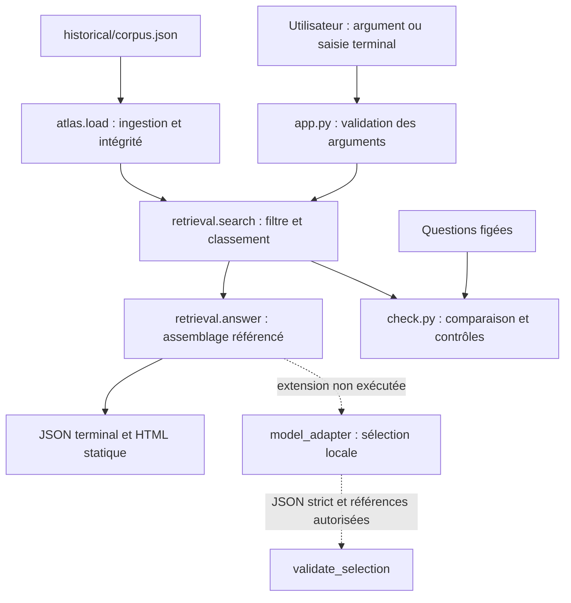

# Construire un atlas documentaire traçable — tutoriel v1

Ce compagnon montre comment passer de six cartes éditoriales à une réponse documentaire référencée. Il contient du code fonctionnel, une interface terminal, un export HTML et une comparaison mesurée. Deux publications seulement sous-tendent les six cartes : elles ne représentent pas six preuves indépendantes. Aucun modèle IA n’a été exécuté. Le code est consultable ; aucune licence de réutilisation n’est accordée pour le moment. La CC BY 4.0 des publications ne couvre pas globalement le code. Conserver `historical/THIRD_PARTY_NOTICES.md` avec les cartes.

## 1. Préparer un environnement propre

Prérequis exact de l’exécution conservée : CPython **3.9.6**, macOS **26.2**, arm64. Aucune bibliothèque tierce, aucun pip, aucune clé, aucun accès réseau au lancement. Python 3.9.6 décrit cette reproduction historique, pas une recommandation de version de production. Linux et d’autres versions Python ne sont pas testés ; Windows natif ne prend pas en charge le module `resource` utilisé par l’évaluation. La CLI n’utilise pas ce module, mais n’a pas été testée sous Windows.

Depuis la racine de l’archive extraite :

```sh
python3 --version
python3 -m venv --without-pip .venv
.venv/bin/python -B app.py 'suivi médian 7,6 ans' --html sourced.html
.venv/bin/python -B app.py 'astronomie Saturne' --html abstention.html
.venv/bin/python -B check.py --out runs/my-first-run
```

Ne remplacez pas `runs/clean-1` : c’est la trace livrée. Le nouveau dossier de sortie doit être absent. `-B` évite les caches Python. `venv` isole les paquets de l’environnement ; il partage l’interpréteur installé, ce n’est pas une machine vierge ni une image système. [Documentation officielle venv](https://docs.python.org/3.9/library/venv.html).

L’invite interactive est également fonctionnelle :

```sh
.venv/bin/python -B app.py
```

Saisir `astronomie Saturne`, puis Entrée. La sortie JSON contient `status: abstention`, `statements: []`, `evidence: []` et `ai_executed: false`. Les deux commandes avec arguments sont réellement appelées par `check.py` dans des sous-processus. Les sorties intégrales et HTML correspondants sont dans `runs/clean-1/`. L’invite est conservée dans `interactive.txt`.

## 2. Architecture et responsabilités



`app.py` est la frontière utilisateur : une chaîne de 1 à 2000 caractères et un filtre optionnel. `historical/atlas.py` charge et vérifie les cartes ; il ne va pas chercher les publications sur Internet. `retrieval.py` réalise la recherche puis assemble les textes existants. `check.py` compare l’ancien et le nouveau moteur. L’extension de modèle reste un module distinct : elle ne s’active pas en lançant l’application.

Le choix est volontairement sans framework applicatif : `argparse` fournit l’interface, `json` le contrat et `pathlib` les chemins. Cela rend chaque étape inspectable et l’installation hors ligne. Un serveur FastAPI pourrait exposer la même fonction `app.run(query, level)` via HTTP ; il faudrait alors ajouter dépendances, validation HTTP, limites de requêtes et tests du transport. Une interface Streamlit faciliterait une démonstration visuelle, au prix d’une dépendance d’exécution. Ces alternatives ne sont ni installées ni validées ici. Pour six cartes, une base vectorielle n’est pas nécessaire au parcours démontré ; son bénéfice serait à mesurer sur un corpus et un jeu d’essai séparés.

## 3. Ingestion et schéma des preuves

Ouvrez `historical/corpus.json`, puis `historical/atlas.py`, fonction `load`. Chaque carte porte :

| Champ | Contrat et rôle |
|---|---|
| `id`, `source_id` | Identifiant unique de carte ; publication partagée par plusieurs cartes |
| `text`, `text_sha256` | Reformulation française et empreinte du texte UTF-8 |
| `title`, `url`, `locator` | Titre, URL HTTPS et repère dans la publication |
| `disease`, `evidence_level` | Métadonnées éditoriales ; le niveau est contrôlé contre une liste fermée |
| `published_at`, `accessed_at` | Dates ISO de publication et consultation |
| `attribution`, `license`, `license_url`, `changes` | Crédits, licence et modifications explicites |

Le chargeur rejette champs manquants, doublons d’identifiants, dates invalides, URL non HTTPS, licence non admise et empreinte différente. Les empreintes attestent une intégrité locale, pas une vérité scientifique. Les champs `source_text`, `start` et `end` existent temporairement pour compatibilité avec l’ancien moteur ; les sorties nouvelles n’en font pas des citations originales. `original_quote` reste faux.

Les cartes ont déjà été préparées depuis les sources : cette ingestion n’est pas une extraction automatique de PDF. Les références bibliographiques et corrections historiques sont dans `historical/SOURCES.md` et `historical/THIRD_PARTY_NOTICES.md`. D06 est une **réserve de la rédaction**, pas un résultat attribuable à Porro. La référence GNT0003 n’est pas documentée dans ce paquet. Le nouveau contrat l’indique via `editorial_reservation: true` ; l’export HTML porte également cette réserve.

Pour ajouter une carte lors d’une expérience ultérieure, travailler sur une nouvelle version de corpus : renseigner provenance, licence, changements et texte ; calculer SHA-256 du texte exact ; faire passer `atlas.load` ; créer des questions nouvelles avant d’ajuster le moteur. Ne pas changer `historical/` pour améliorer les scores de cette expérience.

## 4. Suivre une requête jusqu’à sa référence

`app.run('suivi médian 7,6 ans')` charge les cartes, appelle `retrieval.search`, puis `retrieval.answer`. La tokenisation retire les accents et certains mots grammaticaux. Les nombres d’un seul caractère sont éliminés par le tokenizer historique : le score ne garantit donc pas une correspondance numérique exacte. Le score est `nombre de termes de requête présents / nombre de termes de requête`, après normalisation. Seuil conservé : **0,6** ; tri décroissant puis identifiant pour départager. Ce score n’est ni une probabilité ni un niveau de confiance scientifique.

La première preuve retournée est D01, reliée à S08, avec son URL, son repère `Abstract`, ses crédits et son empreinte. `statements[0].text` recopie la reformulation de D01 ; `statements[0].references` vaut `["D01"]`. L’assemblage ne rédige pas de conclusion nouvelle. Pour inspecter les scores et termes communs, lire `search.hits[].lexical_coverage` et `matched_terms` dans la sortie JSON.

Le filtre `--level preclinique` est appliqué avant le classement. Le niveau provient du classement éditorial des cartes : le logiciel n’a pas classifié la qualité d’un essai. Une porte lexicale historique bloque certains termes de demande médicale ou de conception biologique ; elle est incomplète et n’est pas un système de sûreté validé. Si aucune carte n’atteint le seuil, la liste de preuves est vide et le statut est `abstention`.

## 5. Comprendre et mesurer l’amélioration

Le moteur initial échoue sur Q07–Q09 (paraphrases) et Q10–Q11 (faux positifs hors corpus). La révision ajoute trois équivalences explicites : `plaquettes → plaquettaire`, `corrigees → correction`, `etude → publication`, puis enlève quelques pronoms/verbes grammaticaux. Elle conserve seuil, corpus, questions et règles de classement. Consulter `retrieval.ALIASES` et `GRAMMAR` : aucun dictionnaire caché, apprentissage ou encodeur.

Résultat réellement exécuté : **15/20 → 17/20**. Q08 et Q09 passent ; Q07 reste sans réponse, car « personnes suivies » et « participants » ne sont pas rapprochés. Q10 et Q11 restent des faux positifs : une couverture lexicale élevée peut masquer « astronomie » ou « diabète ». Ajouter seulement ces deux mots à une liste noire améliorerait artificiellement ce jeu connu. Une suite possible serait un détecteur de périmètre évalué sur de nouvelles questions contradictoires ; elle n’est pas réalisée ici.

Ce résultat mesure la satisfaction des attendus du premier résultat, ou l’absence de résultat pour une abstention attendue. Il ne mesure pas la validité biologique, la qualité globale d’une réponse, ni l’utilité utilisateur. Les questions étaient connues pendant le développement : c’est une amélioration sur jeu de développement, pas un test indépendant. Une revue indépendante du paquet est favorable à l’intégration ; une évaluation sur un jeu tenu à l’écart reste nécessaire pour établir une généralisation.

`runs/clean-1/comparison.json` conserve pour chaque question les deux sorties complètes et verdicts. `execution.json` décrit versions, durée, CPU, pic mémoire et disponibilité des bibliothèques. `controls.json` consigne les contrôles de provenance, références, interface et échappement. Les exports historiques sont inchangés dans `historical/results` et `historical/reproduction`.

## 6. Dépannage et limites pratiques

| Symptôme | Action |
|---|---|
| `FileExistsError` à l’évaluation | Choisir un nouveau dossier `--out`, conserver la trace précédente |
| Python absent ou autre version | Installer/préparer séparément un interpréteur approprié ; l’installation système n’est pas effectuée par ce paquet |
| `resource` introuvable | Évaluation sous Unix requise ; Windows natif non validé |
| Métadonnée ou empreinte invalide | Vérifier le fichier par rapport au manifeste ; ne pas masquer l’erreur en recalculant aveuglément une empreinte |
| Pas de réponse à une paraphrase | Inspecter `normalized_query` et les limites du dictionnaire ; ne pas présenter l’abstention comme absence de preuve scientifique |
| Mauvaise réponse hors corpus | Conserver l’échec et élargir les tests avant toute intégration publique |
| Module Torch/Transformers absent | Attendu pour le parcours principal ; voir extension proposée, ne pas installer automatiquement |

Les chemins de données sont relatifs au fichier `app.py`, pas au répertoire courant. L’HTML est un fichier statique à ouvrir localement ; aucun serveur ni site n’est lancé. La durée CPU de l’évaluation est limitée à 60 secondes pour le processus principal ; chaque sous-processus CLI a un délai mural de 10 secondes. Le budget de cette tâche est de 15 minutes CPU local. Aucun achat, téléchargement de poids ou appel d’API payante n’est nécessaire.

Lire ensuite `MODEL_EXTENSION.md` pour le contrat d’extension et `REPORT.md` pour les mesures et les réserves de livraison.

## Lire le tutoriel et les notices

[Article français](https://www.generativschool.com/genethon-atlas-documentaire-avant-ia.html) · [Compagnon](https://www.generativschool.com/genethon-atlas-documentaire-avant-ia-compagnon.html) · [Notices et droits](https://www.generativschool.com/genethon-atlas-documentaire-avant-ia-notices.html).

Les rapports sources et le répertoire historical conservent leur état de livraison. La revue indépendante tutorial-v1 est favorable à l’intégration, sans défaut substantiel bloquant. Aucun nouveau benchmark exécuté pour cette publication. SOURCE_MANIFEST.json préserve les empreintes sources ; seul ce README est adapté, le manifeste de distribution est recalculé.
